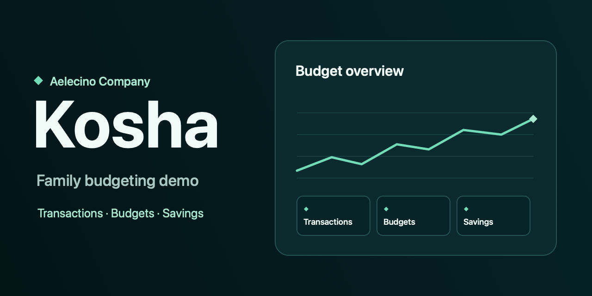

# Kosha

A family budgeting prototype you can explore with a fictional household.

[**Try Kosha online**](https://hushryn.github.io/kosha-demo/) · [Run offline](#run-offline)

## What you can try

- Log income and expenses and review account activity.
- Set spending limits by category and track savings goals.
- Review subscriptions and recurring expenses.

Choose English, Russian, Spanish, German, or French and set your preferred currency.

## Run offline

Open the [HTML file on GitHub](https://github.com/hushryn/kosha-demo/blob/main/kosha-demo.html), select **Download raw file**, and open the downloaded file in your browser. The standalone version runs without installing anything or starting a server. Your changes stay in your browser.
