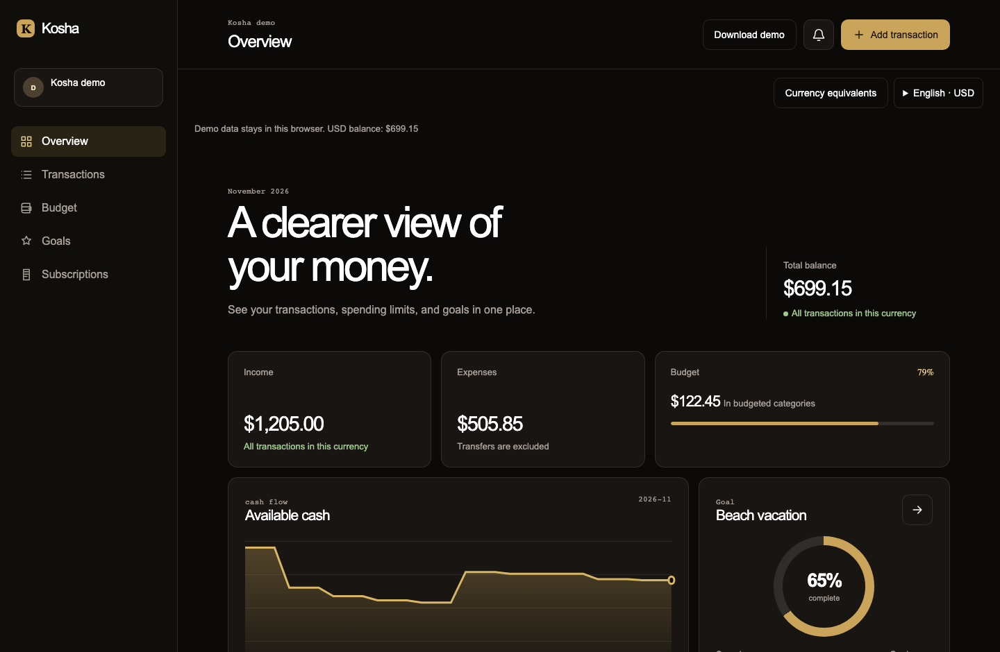

# Kosha

A family budgeting prototype you can explore with a fictional household.

[**Open Kosha**](https://hushryn.github.io/kosha-demo/) · [Get the offline HTML](https://github.com/hushryn/kosha-demo/blob/main/kosha-demo.html)

## Explore the demo

- Log income and expenses and review account activity.
- Set spending limits by category and track savings goals.
- Review subscriptions and recurring expenses.
- Compare amounts using reference exchange rates.

Choose English, Russian, Spanish, German, or French and set your preferred currency. The homepage preview uses the same fictional household as the demo.

## Run offline

Open the [HTML file on GitHub](https://github.com/hushryn/kosha-demo/blob/main/kosha-demo.html), select **Download raw file**, and open the downloaded file in your browser. The standalone version runs without installing anything or starting a server. Your changes stay in your browser.

## Technology

Kosha uses TypeScript and React. Vite bundles the public demo as a standalone HTML file, and GitHub Pages serves it.
